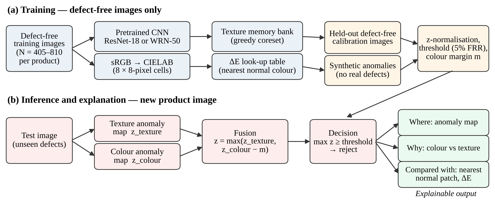

# Detecting unseen food defects with deep learning trained only on defect-free images

Code and results for the article:

> [Authors] (2026). *Detecting unseen defects in food products with deep learning trained only on defect-free images: an explainable machine-vision approach.* Applied Food Research. DOI: [to be added]



## Summary

Supervised deep learning needs labelled images of every defect, which are scarce and never complete in food production. This repository evaluates whether deep learning models trained **exclusively on images of defect-free product** can detect and localise **previously unseen defects**. Under a strict one-class protocol, defective images are used only for evaluation – never for training, threshold setting or model selection.

The proposed **colour–texture (CT) framework** combines

* a **memory bank of pretrained CNN patch features** (PatchCore principle) that models normal texture and shape,
* a **CIELAB colour model** that measures the colour difference ΔE\*ab to the nearest normal colour, and
* a **fusion margin selected on synthetic anomalies**, so that no real defect influences any design choice.

Every detection is **explained** by its location (anomaly map), its attribution to colour or texture evidence, and the most similar normal patch retrieved from the memory bank together with its colour difference.

## Main results (VisA food products, 600 defective and 400 normal test images)

| Method | Image AUROC (%) | Recall (%) | False rejection rate (%) | Precision (%) | F1 | CPU latency (ms) |
|---|---|---|---|---|---|---|
| **CT-R18 (proposed)** | **95.8** | **86.5** | 6.0 | 95.6 | **0.908** | 68 |
| CT-WRN50 | 94.2 | 79.2 | 4.2 | 96.5 | 0.870 | 452 |
| PatchCore-WRN50 | 93.9 | 75.3 | 4.0 | 96.6 | 0.846 | 477 |
| PaDiM-R18 | 85.5 | 52.8 | 5.2 | 93.8 | 0.676 | 69 |
| Convolutional autoencoder | 81.0 | 51.3 | 8.8 | 89.8 | 0.653 | 11 |
| CIELAB-ΔE (colour only) | 79.7 | 54.8 | 15.5 | 84.1 | 0.664 | 5 |

The decision threshold was set on defect-free calibration images at a target false rejection rate of 5%. Per-product results, confidence intervals and defect-category results are in [`results/`](results/).

## Repository structure

```
notebooks/
  01_main_study.ipynb                    full study: all methods, all products, tables and figures
  02_figures_explanations_roc_xai.ipynb  qualitative figures, explanation cards, ROC curves, XAI deletion test
  03_inspection_tool.ipynb               classify and segment new images or videos with a trained model
src/                                     the same code as plain Python scripts
  goodonly_study.py                      = notebook 01
  qualitative_figures.py                 = notebook 02, step 1
  explanation_cards.py                   = notebook 02, step 2
  roc_and_xai.py                         = notebook 02, step 3
  inspection_tool.py                     = notebook 03 (also offers a live-camera mode)
scripts/
  make_paper_figures.py                  redraws Figs. 1, 3, 4, 6, 7 and 8 from results/
results/                                 result tables of the reported run
figures/                                 manuscript figures (600 dpi)
```

## How to reproduce

The notebooks are designed for **Google Colab** with a T4 GPU.

1. Open a notebook in Colab and select **Runtime → Change runtime type → T4 GPU**.
2. Select **Runtime → Run all** and allow access to Google Drive.
3. The VisA dataset (about 1.9 GB) is downloaded automatically on the first run and kept in `MyDrive/food_defects/data`; results are written to `MyDrive/food_defects/results`.

| Notebook | Runtime on a T4 GPU |
|---|---|
| 01_main_study | about 1.5–2.5 h |
| 02_figures_explanations_roc_xai | about 1.5–2 h |
| 03_inspection_tool | about 20–30 min for all test images |

To redraw the summary figures locally from the stored result tables:

```bash
pip install -r requirements.txt
python scripts/make_paper_figures.py --results results --out figures
```

All experiments use a fixed random seed. Minor numerical differences can occur between GPU types and library versions.

## Data

The study uses the six food products of the **VisA** dataset (Zou et al., 2022; cashew, chewing gum, fryum, pipe fryum, macaroni 1 and macaroni 2), distributed by Amazon under the [CC BY 4.0](https://creativecommons.org/licenses/by/4.0/) licence. The images are not included in this repository; the code downloads them from the official source.

> Zou, Y., Jeong, J., Pemula, L., Zhang, D., & Dabeer, O. (2022). SPot-the-difference self-supervised pre-training for anomaly detection and segmentation. *ECCV 2022*, LNCS 13690, 392–408.

## Method names

| Name | Description |
|---|---|
| CT-R18 | Colour–texture fusion with a ResNet-18 backbone (memory ≤ 10,000 patches) – proposed lightweight model |
| CT-WRN50 | Colour–texture fusion with a WideResNet-50 backbone (memory ≤ 40,000 patches) |
| PatchCore-WRN50 | Texture memory bank only (Roth et al., 2022) |
| PaDiM-R18 | Gaussian model of ResNet-18 features per position (Defard et al., 2021) |
| CAE | Convolutional autoencoder, reconstruction error |
| CIELAB-ΔE | Colour model only |

## Citation

Please cite the article above if you use this code (see [`CITATION.cff`](CITATION.cff)).

## Licence

Code: [MIT](LICENSE). Data: VisA, CC BY 4.0 (not redistributed here).
